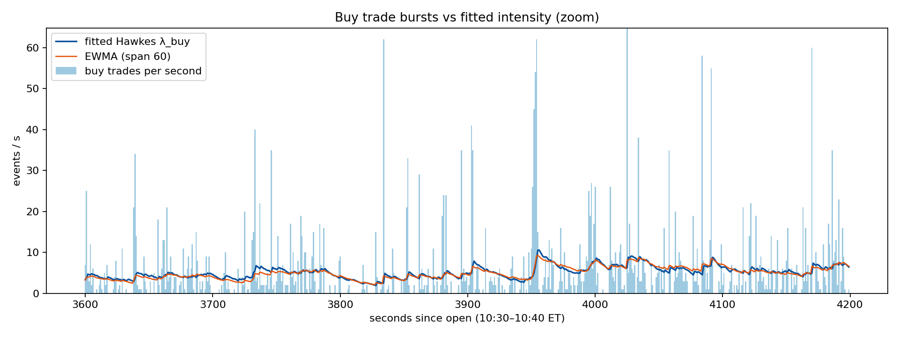
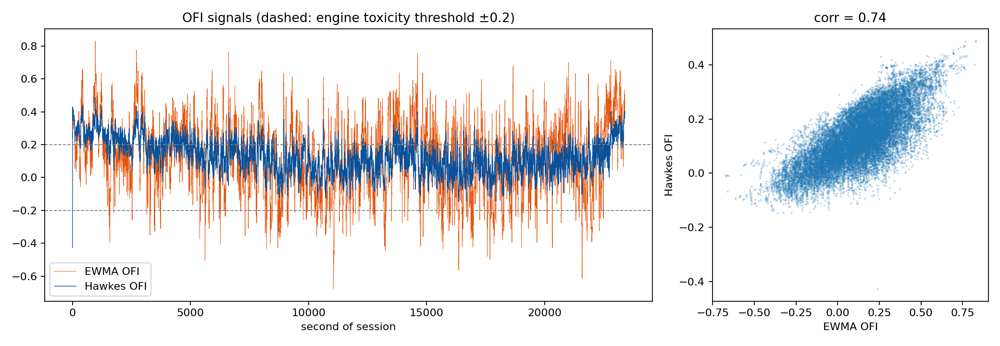
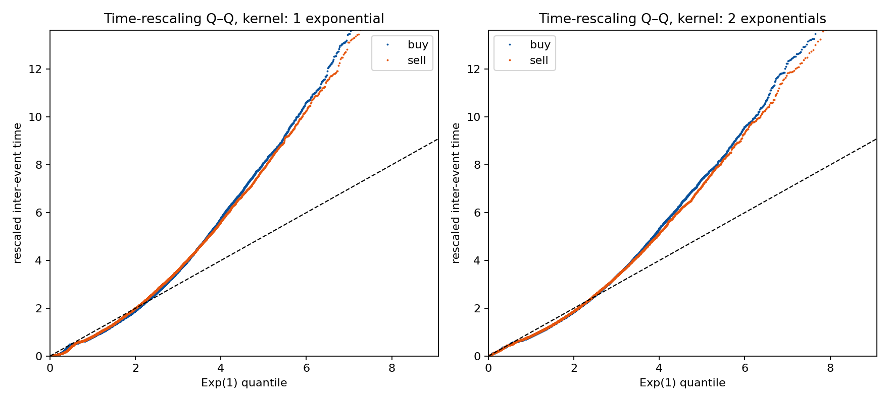
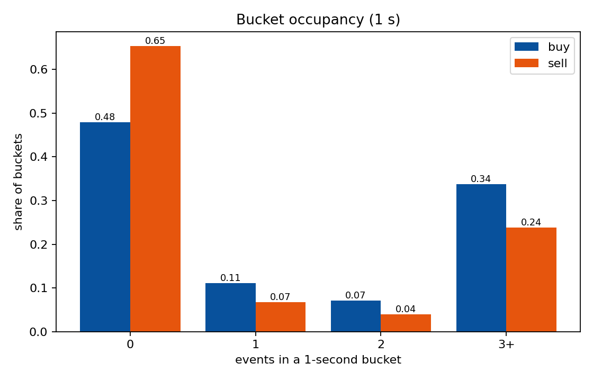
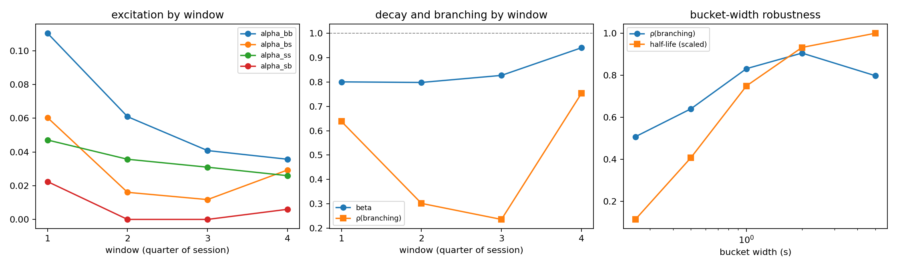

# Hawkes calibration report

_Generated by `scripts/hawkes_diagnostics.py` (`make diagnostics`). Do not edit by hand._

Data: AAPL, 2024-06-03, regular session, 164,922 Lee–Ready-labelled trades (97,413 buy, 67,509 sell), 23,400 one-second buckets. **One day, one symbol, in-sample: everything below is descriptive.**

## Model and estimator

Step 2 fits a discrete bivariate Hawkes recursion with a **shared decay β**:

```
λ_b[t] = μ_b + β λ_b[t−1] + α_bb N_b[t−1] + α_bs N_s[t−1]
λ_s[t] = μ_s + β λ_s[t−1] + α_ss N_s[t−1] + α_sb N_b[t−1]      λ[0] = μ
```

The estimator is a **Poisson quasi-MLE** on bucket counts: it maximises Σ N log λ − λ, treating each bucket count as Poisson given the past. This is an approximation of the exact point-process likelihood, not the exact MLE. It is minimised with L-BFGS-B (numerical gradients, maxiter 500) from x0 = [½·mean N_b, ½·mean N_s, 0.10, 0.03, 0.10, 0.03, 0.60], with bounds μ ∈ [1e-6, 50], α ∈ [0, 5], β ∈ [0, 0.999]. Penalties are added for β ≥ 0.999, β < 0 and Σα > 5. The bounds already keep β < 0.999, so the β penalty never binds, and **no constraint on the spectral radius is enforced**. Stationarity is checked after the fit instead (below).

The vectorised recursion in this script matches step 2's loop to 3.2e-14. Refit: −loglik -75751.97 vs committed -75751.97.

| parameter | refit | committed |
|---|---:|---:|
| mu_buy | 0.02404 | 0.02404 |
| mu_sell | 0.05986 | 0.05986 |
| alpha_bb | 0.04051 | 0.04051 |
| alpha_bs | 0.01782 | 0.01782 |
| alpha_ss | 0.01981 | 0.01981 |
| alpha_sb | 0.01237 | 0.01237 |
| beta | 0.94194 | 0.94194 |

## 1. Bucket occupancy

| side | 0 | 1 | 2 | 3+ | mean | var/mean |
|---|---:|---:|---:|---:|---:|---:|
| buy | 0.480 | 0.111 | 0.071 | 0.338 | 4.16 | 35.3 |
| sell | 0.654 | 0.068 | 0.040 | 0.238 | 2.88 | 19.1 |

**Finding:** multi-event buckets are common, not rare: up to 34% of buckets hold 3 or more trades. Counts are also heavily over-dispersed (var/mean ≫ 1). So the 1-second quasi-likelihood throws away the within-bucket timing that drives self-excitation. That is why the exact continuous-time fit below disagrees with it so much.

## 2. Null models

| model | free params | loglik | AIC | BIC |
|---|---:|---:|---:|---:|
| poisson | 2 | 45538.2 | -91072.4 | -91054.9 |
| hawkes_no_cross | 5 | 74021.4 | -148032.7 | -147989.0 |
| hawkes_full | 7 | 75752.0 | -151489.9 | -151428.7 |

LR(full vs Poisson) = 60427.6; LR(full vs no-cross) = 3461.2 (2 restrictions). Quasi-likelihood on bucket counts; LR statistics are diagnostic only (chi-square asymptotics need the model to be correctly specified). Clustering is overwhelming. Cross-excitation improves AIC and BIC as well.

## 3. Stability

- Spectral radius of the one-step companion matrix βI + α: **0.9902** (must be < 1 for a stationary mean).
- Branching matrix α/(1−β) = [[0.698, 0.307], [0.213, 0.341]]. Its spectral radius is **0.831** (expected events triggered per event, all generations counted through the dominant mode).
- Decay half-life: 11.6 buckets (seconds).

Note: in this discrete parameterisation the branching ratio is α/(1−β), not α/β.

## 4. Bucket-width robustness

μ is rescaled to events per second, and β to a per-second decay rate (−ln β / Δ) and half-life. α and the branching ratio are unitless, so they are directly comparable across widths.

| width_s | mu_buy_per_s | mu_sell_per_s | alpha_bb | alpha_sb | beta | half_life_s | spectral_radius_branching | share_buckets_ge2_buy |
|---:|---:|---:|---:|---:|---:|---:|---:|---:|
| 0.250 | 0.169 | 0.177 | 0.045 | 0.007 | 0.906 | 1.753 | 0.507 | 0.138 |
| 0.500 | 0.033 | 0.102 | 0.029 | 0.005 | 0.946 | 6.300 | 0.640 | 0.246 |
| 1.000 | 0.024 | 0.060 | 0.041 | 0.012 | 0.942 | 11.588 | 0.831 | 0.409 |
| 2.000 | 0.060 | 0.069 | 0.067 | 0.025 | 0.908 | 14.419 | 0.905 | 0.625 |
| 5.000 | 0.137 | 0.223 | 0.136 | 0.057 | 0.799 | 15.467 | 0.798 | 0.898 |

**Finding:** the branching ratio is fairly robust to the bucket width, ranging from 0.51 to 0.91. The half-life is less robust: it grows from 1.8 s to 15.5 s as the buckets widen. That drift is mild evidence that one exponential time scale is a compromise across several scales, which the exact fit below confirms.

## 5. Sub-window stability (4 equal blocks)

| window | start | mu_buy | mu_sell | alpha_bb | alpha_bs | alpha_ss | alpha_sb | beta | spectral_radius_branching | buy_rate_per_s |
|---|---|---|---|---|---|---|---|---|---|---|
| 1 | 13:30:00 | 0.4056 | 0.5524 | 0.1105 | 0.0604 | 0.0471 | 0.0224 | 0.8004 | 0.6380 | 7.7720 |
| 2 | 15:07:30 | 0.3558 | 0.3909 | 0.0610 | 0.0161 | 0.0357 | 0.0000 | 0.7980 | 0.3018 | 2.7879 |
| 3 | 16:45:00 | 0.3140 | 0.2887 | 0.0408 | 0.0118 | 0.0310 | 0.0000 | 0.8270 | 0.2361 | 2.5538 |
| 4 | 18:22:30 | 0.0353 | 0.0702 | 0.0357 | 0.0293 | 0.0260 | 0.0060 | 0.9403 | 0.7533 | 3.5381 |

**Finding:** the parameters move a lot across the day. The per-window branching ratio ranges from 0.24 to 0.75, all below the full-day value of 0.83. The trade rate also changes (2.6–7.8 buys/s, highest in the block containing the open). A constant baseline μ cannot follow that intraday seasonality, so the full-day fit attributes part of it to self-excitation and is **biased toward criticality**. A time-varying baseline would be the fix.

Step 2 also fits the parameters **on the whole day and then uses the intensities in-sample**. That is look-ahead in the parameters, though not in the recursion itself. A walk-forward fit (calibrate on a past window, apply to the next) is needed before any out-of-sample claim.

## 6. Exact continuous-time fit and time-rescaling goodness of fit

Event times come from `trades_labeled.parquet`. 68,428 trades that share a nanosecond timestamp and side with another trade were collapsed into one event (one aggressive order sweeping several resting orders), leaving 96,494 events. The kernel is φ_ij(t) = Σ_k α_ij^k ω_k e^{−ω_k t} with decays shared across pairs. Fitted by exact MLE (L-BFGS-B on log-parameters). Ogata's time rescaling should turn inter-event compensator increments into i.i.d. Exp(1) if the model is right.

| kernel | loglik | AIC | decay half-lives (s) | ρ(branching) | KS buy (stat, p) | KS sell (stat, p) |
|---|---:|---:|---|---:|---|---|
| 1 exponential(s) | 288870 | -577725 | 0.000203 | 0.595 | 0.116, 0.0e+00 | 0.144, 0.0e+00 |
| 2 exponential(s) | 312466 | -624909 | 4.08e-05, 0.00159 | 0.644 | 0.071, 2.7e-254 | 0.063, 1.1e-134 |
| 3 exponential(s) | 323601 | -647169 | 2.84e-05, 0.000653, 0.169 | 0.778 | 0.034, 3.7e-58 | 0.044, 1.0e-64 |

The discrete fit implies a decay of 0.0598/s (half-life 11.6 s) and a branching radius of 0.831. The AIC-best exact fit (3 exponentials) has half-lives of 2.84e-05, 0.000653, 0.169 s and a radius of 0.778.

**Finding:** the two estimators describe different phenomena. On event time, the excitation that dominates is at **millisecond** scale or below, invisible to 1-second buckets. The 12-second decay of the discrete fit is a separate, slower clustering, and the discrete model forces both into one β. Each extra exponential raises the likelihood a lot, which fits the multi-scale, slowly decaying kernels reported in the literature (Bacry, Jaisson & Muzy, 2016). Even so, with ~10⁵ events the KS test rejects every kernel tried. The Q–Q plot shows the misfit is in the tails (rescaled variance > 1: residual clustering is left). Treat the Hawkes intensities as a **descriptive feature generator**, not a correctly specified model. The 1-ns nudge used to break exact ties between buy and sell events, and the collapsing of same-timestamp trades, are modelling choices that affect the shortest time scale.

## Figures











## Limitations

- One day, one symbol. Nothing here is evidence about other days.
- Trade signs come from Lee–Ready against 1-second quotes (see README, *Changes*, on the look-ahead fix to the labelling). Sign errors bias cross-excitation upward.
- The quasi-MLE ignores within-bucket timing, and the shared β forces one time scale on all four interactions.
- No parameter uncertainty is reported yet (bootstrap or observed information). Power-law kernels were not fitted; sums of up to three exponentials stand in for them.
- The parameters are estimated on the same day the engine trades. Hawkes features used in the engine are in-sample.
